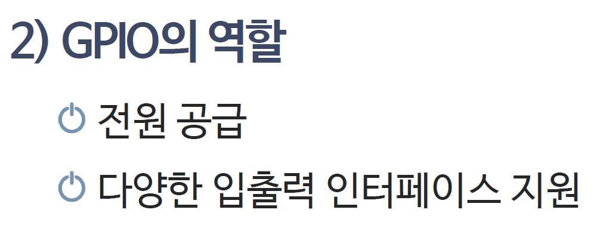
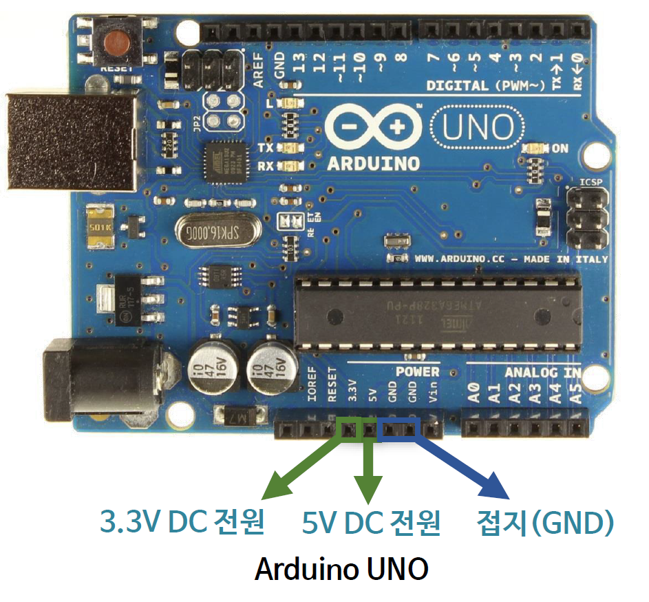
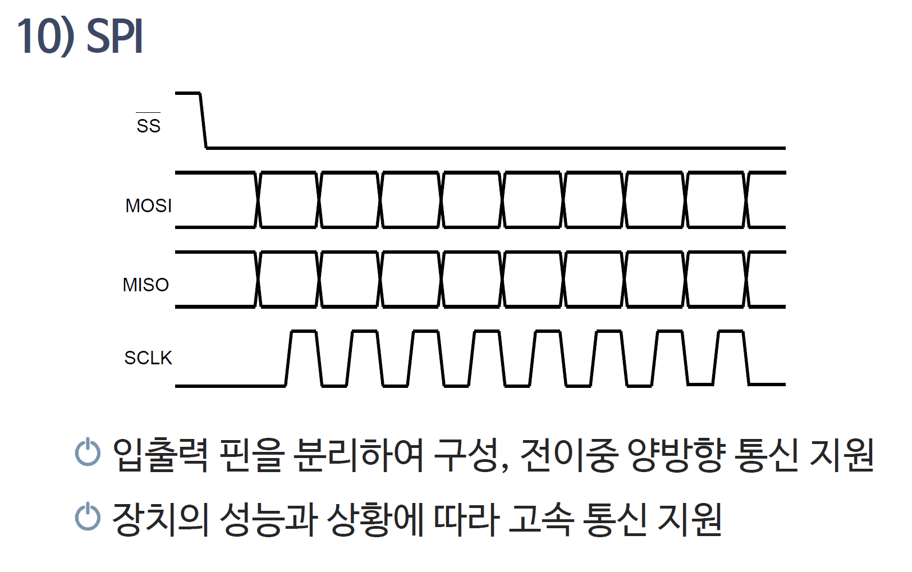
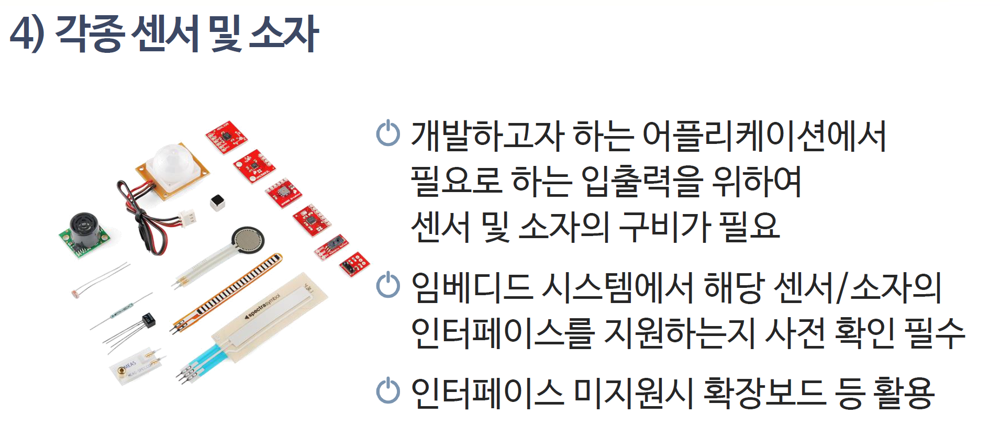

# 191_라즈베리파이_기초 🍓🤖


**도로시와 지니가 함께하는 싱글보드 컴퓨터와 I2C 협동 제어**
* 👧 **도로시**: "지니야! 손바닥만 한 초록색 기판에 모니터랑 마우스를 꽂으니 진짜 컴퓨터 화면이 떠! 아두이노랑 뭐가 달라?"
* 🐱 **지니**: "이건 진짜 리눅스 OS가 돌아가는 초소형 미니 PC **라즈베리파이(Raspberry Pi)** 란다! 아두이노와 찰떡궁합이지!"
* 🐶 **토토**: "바우! 라즈베리파이가 두뇌, 아두이노가 손발이다 멍!"
* 📖 **상세 강의 교재**: [index.md](./index.md)


> 여러분 안녕하세요! 이번 시간에는 '191. 라즈베리파이 기초 🍓🤖'을 주제로 함께 흥미진진한 탐험을 떠나보겠습니다. 오늘 강의에서는 특히 도로시와 지니가 함께하는 싱글보드 컴퓨터와 I2C 협동 제어, 👧 도로시: "지니야! 손바닥만 한 초록색 기판에 모니터랑 마우스를 꽂으니 진짜 컴퓨터 화면이 떠! 아두이노랑 뭐가 달라?"를 중심으로 핵심 원리와 응용 방법을 차근차근 배워보겠습니다. 마법 멘토 지니와 호기심 많은 탐험가 도로시, 그리고 귀여운 토토와 함께 신나는 아두이노 모험을 힘차게 시작해 봅시다. 준비되셨나요?

---

## 1. 아두이노 vs 라즈베리파이 역할 분담


* **라즈베리파이 (두뇌 - Brain)**:
* 리눅스 운영체제, 파이썬(Python), 인공지능 영상인식(OpenCV), 웹서버 실행!
* 복잡한 계산과 네트워크 데이터베이스 처리를 담당해요.
* **아두이노 (손과 발 - Hands & Feet)**:
* 마이크로초 단위의 정밀한 모터 회전 제어, 아날로그 센서 측정!
* ➡️ **두 장치가 I2C로 손을 잡으면 최첨단 인공지능 로봇 탄생!**

### 🤝 최강의 드림팀 파트너십!

> 이번 슬라이드에서는 '1. 아두이노 vs 라즈베리파이 역할 분담'에 대해 자세히 살펴보겠습니다. 화면의 다이어그램과 사진을 함께 참고해 주시기 바랍니다. 첫 번째 핵심은 라즈베리파이 (두뇌 - Brain)이며, 두 번째로는 리눅스 운영체제, 파이썬(Python), 인공지능 영상인식(OpenCV), 웹서버 실행!입니다. 여기에 덧붙여 복잡한 계산과 네트워크 데이터베이스 처리를 담당해요. 내용까지 함께 이해해 두시면 완벽합니다. 이 원리는 아두이노 시스템 전체를 관통하는 핵심 논리이므로 머릿속에 꼭 정리해 두시기 바랍니다.

---

## 2. 라즈베리파이와 아두이노 I2C 결선도



* **라즈베리파이 GPIO (3.3V 로직)**:
* Pin 3: **SDA (GPIO 2)** ➡️ 아두이노 **A4 (SDA)**
* Pin 5: **SCL (GPIO 3)** ➡️ 아두이노 **A5 (SCL)**
* Pin 6: **GND** ➡️ 아두이노 **GND**
* *주의*: 라즈베리파이는 3.3V이므로 신호선에 전압 레벨 시프터(Level Shifter)를 사용하면 더욱 안전해요!

### 🔌 전압 레벨에 주의하며 3가닥 연결!

> 이번 슬라이드에서는 '2. 라즈베리파이와 아두이노 I2C 결선도'에 대해 자세히 살펴보겠습니다. 화면의 다이어그램과 사진을 함께 참고해 주시기 바랍니다. 첫 번째 핵심은 라즈베리파이 GPIO (3.3V 로직)이며, 두 번째로는 Pin 3: SDA (GPIO 2) ➡️ 아두이노 A4 (SDA)입니다. 여기에 덧붙여 Pin 5: SCL (GPIO 3) ➡️ 아두이노 A5 (SCL) 내용까지 함께 이해해 두시면 완벽합니다. 이 원리는 아두이노 시스템 전체를 관통하는 핵심 논리이므로 머릿속에 꼭 정리해 두시기 바랍니다.

---

## 3. 라즈베리파이 터미널에서 I2C 장치 검색



* 라즈베리파이 리눅스 터미널 창을 열고 명령어를 칩니다:
* 1번 버스 격자판에 우리가 아두이노 슬레이브로 지정한 번호(예: **`0x08`**)가 선명하게 나타나면 통신 선로 연결 완료!

### 🔍 `i2cdetect -y 1` 명령어로 주소 찾기!

  ```bash
  sudo i2cdetect -y 1
  ```

> 이번 슬라이드에서는 '3. 라즈베리파이 터미널에서 I2C 장치 검색'에 대한 실제 동작 코드를 분석해 보겠습니다. 화면의 코드를 살펴보시면, 컴퓨터가 아두이노 하드웨어에 단계별로 명령을 내리는 흐름을 명확하게 확인할 수 있습니다. 여기서 핵심은 라즈베리파이 리눅스 터미널 창을 열고 명령어를 칩니다입니다. 각 함수의 역할과 괄호 안의 매개변수가 하드웨어 핀과 어떤 관계를 맺고 동작하는지 주의 깊게 살펴보시기 바랍니다.

---

## 4. 파이썬(Python) 마스터 스크립트 작성



* 라즈베리파이 파이썬 창에서 `1`을 치면 아두이노가 즉시 불을 켭니다!

### 🐍 `smbus` 라이브러리로 아두이노에 명령 보내기

```python
import smbus
import time

bus = smbus.SMBus(1)    # 1번 I2C 버스 개방
address = 0x08          # 아두이노 슬레이브 주소

while True:
    cmd = int(input("1: LED ON, 0: LED OFF -> "))
    bus.write_byte(address, cmd) # 아두이노로 1바이트 슝!
    time.sleep(1)
```

> 이번 슬라이드에서는 '4. 파이썬(Python) 마스터 스크립트 작성'에 대한 실제 동작 코드를 분석해 보겠습니다. 화면의 코드를 살펴보시면, 컴퓨터가 아두이노 하드웨어에 단계별로 명령을 내리는 흐름을 명확하게 확인할 수 있습니다. 여기서 핵심은 라즈베리파이 파이썬 창에서 1을 치면 아두이노가 즉시 불을 켭니다!입니다. 각 함수의 역할과 괄호 안의 매개변수가 하드웨어 핀과 어떤 관계를 맺고 동작하는지 주의 깊게 살펴보시기 바랍니다.

---

## 5. 아두이노 슬레이브 수신 스케치



### 📥 `Wire.onReceive`로 라즈베리파이 명령 수행!

```cpp
#include <Wire.h>
const int ledPin = 13;

void setup() {
  Wire.begin(0x08);             // 주소 8번 슬레이브 모드
  Wire.onReceive(receiveEvent); // 수신 이벤트 등록
  pinMode(ledPin, OUTPUT);
}

void loop() { delay(100); }

void receiveEvent(int bytes) {
  int cmd = Wire.read();
  if (cmd == 1) digitalWrite(ledPin, HIGH);
  else if (cmd == 0) digitalWrite(ledPin, LOW);
}
```

> 이번 슬라이드에서는 '5. 아두이노 슬레이브 수신 스케치'에 대한 실제 동작 코드를 분석해 보겠습니다. 화면의 코드를 살펴보시면, 컴퓨터가 아두이노 하드웨어에 단계별로 명령을 내리는 흐름을 명확하게 확인할 수 있습니다. 각 함수의 역할과 괄호 안의 매개변수가 하드웨어 핀과 어떤 관계를 맺고 동작하는지 주의 깊게 살펴보시기 바랍니다.

---

## 🌟 도로시와 지니의 핵심 요약 노트!


* 👧 **도로시**: "라즈베리파이 파이썬 코드로 아두이노에게 명령을 보내니 진짜 인공지능 로봇을 만들 수 있겠어!"
* 🐱 **지니**: "맞아! 고성능 두뇌(라즈베리파이)와 정밀한 손발(아두이노)이 결합된 최고의 엔지니어링 협업이란다."
* 🐶 **토토**: "바우! 이제 마지막 보너스 실습 챕터로 가보자 멍!"

> 오늘 배운 '🌟 도로시와 지니의 핵심 요약 노트!'의 핵심 내용을 모두 정리해 보았습니다. 오늘 다룬 내용 중에서도 👧 도로시: "라즈베리파이 파이썬 코드로 아두이노에게 명령을 보내니 진짜 인공지능 로봇을 만들 수 있겠어!" 부분은 앞으로의 아두이노 실습과 프로젝트에서 계속 사용되는 매우 중요한 기초 지식입니다. 오늘 배운 내용을 꼭 다시 한번 복습해 보시고, 다음 강의에서 더욱 신나고 유익한 모험으로 다시 만나겠습니다. 모두 수고 많으셨습니다!