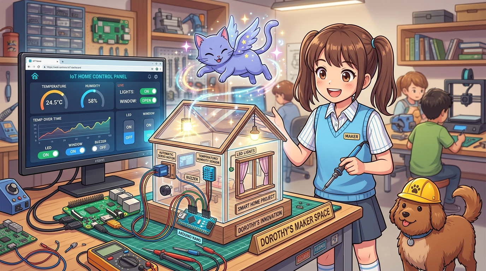

# 192_두뇌와손발_협동프로젝트_스마트홈_AIoT허브 🏡🧠🦾



**도로시와 지니가 함께하는 라즈베리파이 웹 대시보드와 아두이노 엣지 디바이스 융합 시스템**

* 👧 **도로시**: "지니야! 라즈베리파이에서 멋진 웹 브라우저 화면을 띄워서 스마트폰으로 내 방 아두이노 창문과 불빛을 조종하고 싶어!"
* 🐱 **지니**: "드디어 배웠던 모든 기술을 하나로 융합할 때가 왔구나! 라즈베리파이가 **'웹 서버 두뇌'** 가 되고, 아두이노가 **'모터와 센서 손발'** 이 되는 스마트홈 AIoT 시스템을 완성해보자!"
* 🐶 **토토**: "바우! 도둑이 들면 아두이노가 감지하고 파이가 스마트폰으로 알람을 보낸다 멍!"

* 🖥️ **강의 슬라이드**: [slides.md](./slides.md)

---

## 1. 스마트홈 AIoT 시스템 아키텍처


### 🧩 완벽한 역할 분담 시스템 구조

```
    [ 스마트폰 / 태블릿 / 노트북 웹브라우저 ]
                    │  (Wi-Fi 웹 접속 : http://raspberrypi.local:5000)
                    ▼
 ┌──────────────────────────────────────────────────────────┐
 │            라즈베리파이 (중앙 관제 두뇌 / Brain)          │
 │  * Python Flask 경량 웹서버 구동                         │
 │  * 반응형 실시간 IoT 웹 대시보드 제공                    │
 │  * 아두이노 센서 데이터 수집 및 상태 관리               │
 └──────────────────────────┬───────────────────────────────┘
                            │  USB 시리얼 케이블 (안전한 5V/절연)
                            ▼
 ┌──────────────────────────────────────────────────────────┐
 │           아두이노 우노 / 나노 (엣지 액추에이터 / Limbs)  │
 │  * 센서 수집: DHT11 온습도, PIR 침입 감지, CDS 조도     │
 │  * 구동 제어: 서보모터(스마트 창문), 릴레이(LED 조명)   │
 │  * 즉각 반응: 비상 침입 시 즉각 부저(Buzzer) 경보음 발령 │
 └──────────────────────────────────────────────────────────┘
```

---

## 2. 아두이노 엣지 컨트롤러 펌웨어 (C++)

아두이노는 센서를 측정하여 JSON 포맷으로 라즈베리파이에 전송하고, 수신된 명령(`W_OPEN`, `W_CLOSE`, `L_ON`, `L_OFF`)을 즉각 수행합니다.

```cpp
// [SmartHome_Arduino_Limbs.ino]
#include <Servo.h>

const int ledPin = 8;        // 거실 조명 LED
const int buzzerPin = 7;     // 경보 부저
const int pirPin = 2;        // PIR 인체 감지 센서 (디지털 2번)
const int cdsPin = A0;       // 조도 센서 (아날로그 A0)
const int servoPin = 9;      // 창문 제어 서보모터

Servo windowServo;
unsigned long lastSend = 0;
bool motionDetected = false;

void setup() {
  Serial.begin(9600);
  pinMode(ledPin, OUTPUT);
  pinMode(buzzerPin, OUTPUT);
  pinMode(pirPin, INPUT);
  
  windowServo.attach(servoPin);
  windowServo.write(0); // 창문 닫힘 상태 (0도)
}

void loop() {
  // 1. 라즈베리파이 웹서버 명령 수신 처리
  if (Serial.available() > 0) {
    String cmd = Serial.readStringUntil('\n');
    cmd.trim();
    
    if (cmd == "L_ON") digitalWrite(ledPin, HIGH);
    else if (cmd == "L_OFF") digitalWrite(ledPin, LOW);
    else if (cmd == "W_OPEN") windowServo.write(90);  // 창문 90도 열기
    else if (cmd == "W_CLOSE") windowServo.write(0);  // 창문 닫기
  }

  // 2. PIR 센서 침입 감지 (즉각 로컬 부저 울림)
  int pirVal = digitalRead(pirPin);
  if (pirVal == HIGH) {
    motionDetected = true;
    tone(buzzerPin, 1000, 100); // 삐- 침입 경보
  } else {
    motionDetected = false;
  }

  // 3. 1초마다 센서 데이터 패킷을 라즈베리파이로 송신
  if (millis() - lastSend >= 1000) {
    lastSend = millis();
    int light = analogRead(cdsPin);
    float dummyTemp = 24.0 + (random(-5, 5) / 10.0);
    int dummyHum = 55 + random(-3, 3);

    Serial.print("{\"temp\":");
    Serial.print(dummyTemp, 1);
    Serial.print(",\"hum\":");
    Serial.print(dummyHum);
    Serial.print(",\"light\":");
    Serial.print(light);
    Serial.print(",\"pir\":");
    Serial.print(motionDetected ? 1 : 0);
    Serial.println("}");
  }
}
```

---

## 3. 라즈베리파이 Flask 웹 서버 & 대시보드 (`app.py`)

### 📦 1단계: Flask 및 PySerial 설치
```bash
pip3 install flask pyserial
```

### 🐍 2단계: Flask 백엔드 코드 작성 (`app.py`)

```python
from flask import Flask, render_template, jsonify, request
import serial
import threading
import time
import json

app = Flask(__name__)

# 아두이노 시리얼 포트 연결 (/dev/ttyUSB0 또는 /dev/ttyACM0)
try:
    ser = serial.Serial('/dev/ttyUSB0', 9600, timeout=1)
    time.sleep(2)
except Exception as e:
    ser = None
    print(f"Warning: Serial connection failed: {e}")

# 최신 센서 데이터 캐시
home_state = {
    "temp": 24.5,
    "hum": 55,
    "light": 500,
    "pir": 0,
    "led": False,
    "window": False
}

def serial_reader_thread():
    """백그라운드에서 아두이노 데이터를 계속 수신하는 스레드"""
    global home_state
    while True:
        if ser and ser.in_waiting > 0:
            try:
                line = ser.readline().decode('utf-8', errors='ignore').strip()
                if line.startswith('{') and line.endswith('}'):
                    data = json.loads(line)
                    home_state.update(data)
            except Exception:
                pass
        time.sleep(0.1)

# 백그라운드 리더 스레드 시작
threading.Thread(target=serial_reader_thread, daemon=True).start()

@app.route('/')
def index():
    return render_template('index.html')

@app.route('/api/status')
def get_status():
    return jsonify(home_state)

@app.route('/api/control', methods=['POST'])
def control():
    req = request.json
    target = req.get('target')
    action = req.get('action')
    
    cmd = ""
    if target == 'led':
        cmd = "L_ON\n" if action == 'on' else "L_OFF\n"
        home_state['led'] = (action == 'on')
    elif target == 'window':
        cmd = "W_OPEN\n" if action == 'open' else "W_CLOSE\n"
        home_state['window'] = (action == 'open')

    if ser and cmd:
        ser.write(cmd.encode('utf-8'))
        
    return jsonify({"status": "success", "state": home_state})

if __name__ == '__main__':
    # 5000번 포트로 모든 네트워크 접속 허용
    app.run(host='0.0.0.0', port=5000, debug=False)
```

---

## 4. 반응형 스마트홈 웹 대시보드 (`templates/index.html`)

라즈베리파이의 같은 폴더에 `templates` 폴더를 만들고 `index.html` 파일을 작성합니다.

```html
<!DOCTYPE html>
<html lang="ko">
<head>
  <meta charset="UTF-8">
  <title>Dorothy IoT Smart Home</title>
  <style>
    body { font-family: 'Segoe UI', Tahoma, sans-serif; background: #0f172a; color: #f8fafc; margin: 0; padding: 20px; }
    .container { max-width: 600px; margin: 0 auto; background: #1e293b; border-radius: 16px; padding: 24px; box-shadow: 0 10px 25px rgba(0,0,0,0.5); }
    h1 { text-align: center; color: #38bdf8; margin-bottom: 24px; }
    .grid { display: grid; grid-template-columns: 1fr 1fr; gap: 16px; margin-bottom: 24px; }
    .card { background: #334155; padding: 16px; border-radius: 12px; text-align: center; }
    .value { font-size: 28px; font-weight: bold; color: #facc15; margin-top: 8px; }
    .pir-alert { color: #ef4444 !important; animation: blink 1s infinite; }
    @keyframes blink { 50% { opacity: 0.3; } }
    .btn-group { display: flex; gap: 12px; margin-top: 12px; }
    button { flex: 1; padding: 12px; border: none; border-radius: 8px; font-size: 16px; font-weight: bold; cursor: pointer; transition: 0.2s; }
    .btn-on { background: #10b981; color: white; }
    .btn-off { background: #ef4444; color: white; }
    button:hover { opacity: 0.85; transform: scale(1.02); }
  </style>
</head>
<body>
  <div class="container">
    <h1>🏡 Dorothy IoT Smart Home</h1>
    
    <div class="grid">
      <div class="card">
        <div>🌡️ 실내 온도</div>
        <div id="temp" class="value">--.- °C</div>
      </div>
      <div class="card">
        <div>💧 실내 습도</div>
        <div id="hum" class="value">-- %</div>
      </div>
      <div class="card">
        <div>☀️ 조도 센서</div>
        <div id="light" class="value">---</div>
      </div>
      <div class="card">
        <div>🚨 침입 감지 (PIR)</div>
        <div id="pir" class="value">안전</div>
      </div>
    </div>

    <h3>💡 거실 조명 제어</h3>
    <div class="btn-group">
      <button class="btn-on" onclick="sendControl('led', 'on')">조명 켜기 (ON)</button>
      <button class="btn-off" onclick="sendControl('led', 'off')">조명 끄기 (OFF)</button>
    </div>

    <h3>🪟 스마트 창문 제어</h3>
    <div class="btn-group">
      <button class="btn-on" onclick="sendControl('window', 'open')">창문 열기 (OPEN)</button>
      <button class="btn-off" onclick="sendControl('window', 'close')">창문 닫기 (CLOSE)</button>
    </div>
  </div>

  <script>
    function updateDashboard() {
      fetch('/api/status')
        .then(res => res.json())
        .then(data => {
          document.getElementById('temp').innerText = data.temp + ' °C';
          document.getElementById('hum').innerText = data.hum + ' %';
          document.getElementById('light').innerText = data.light;
          const pirEl = document.getElementById('pir');
          if (data.pir === 1) {
            pirEl.innerText = '침입 감지!';
            pirEl.className = 'value pir-alert';
          } else {
            pirEl.innerText = '정상 안전';
            pirEl.className = 'value';
          }
        });
    }

    function sendControl(target, action) {
      fetch('/api/control', {
        method: 'POST',
        headers: { 'Content-Type': 'application/json' },
        body: JSON.stringify({ target: target, action: action })
      }).then(() => updateDashboard());
    }

    setInterval(updateDashboard, 1000);
    updateDashboard();
  </script>
</body>
</html>
```

---

## 5. 실행 및 브라우저에서 제어하기

1. 라즈베리파이 터미널에서 서버를 실행합니다:
   ```bash
   python3 app.py
   ```
2. 같은 공유기(Wi-Fi)에 연결된 스마트폰이나 노트북 웹브라우저 주소창에 다음을 입력합니다:
   ```
   http://raspberrypi.local:5000
   ```
3. 화면에 실시간 온습도 게이지가 1초마다 갱신되며, 화면 속 `[창문 열기]` 버튼을 누르면 아두이노에 달린 서보모터 창문이 스르륵 열립니다!

---

## 🌟 도로시와 지니의 핵심 요약 노트!


* 👧 **도로시**: "라즈베리파이가 웹 서버와 데이터 처리를 맡고, 아두이노가 실시간 모터와 센서를 책임지니 진짜 상용 스마트홈 제품처럼 완벽하게 작동해!"
* 🐱 **지니**: "그렇단다! 초소형 컴퓨터(SBC)의 광대한 네트워크 소프트웨어 파워와 마이크로컨트롤러(MCU)의 정밀한 하드웨어 순발력이 결합될 때 비로소 진정한 차세대 로보틱스·AIoT의 문이 열린단다!"
* 🐶 **토토**: "바우! 라즈베리파이와 아두이노 기초 마스터 완료! 우리 모두 위대한 메이커 엔지니어다 멍!"
